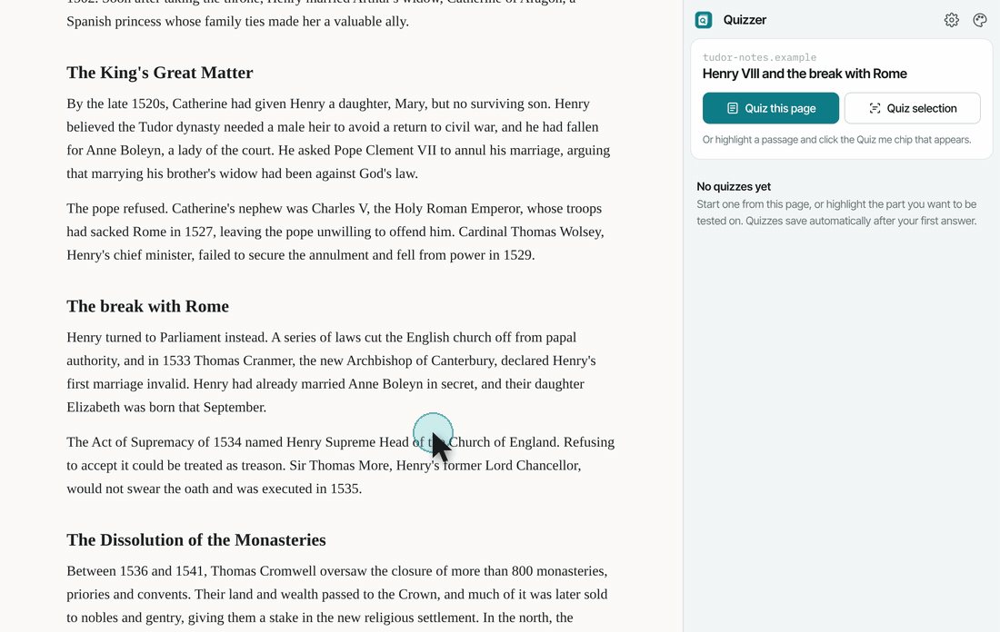
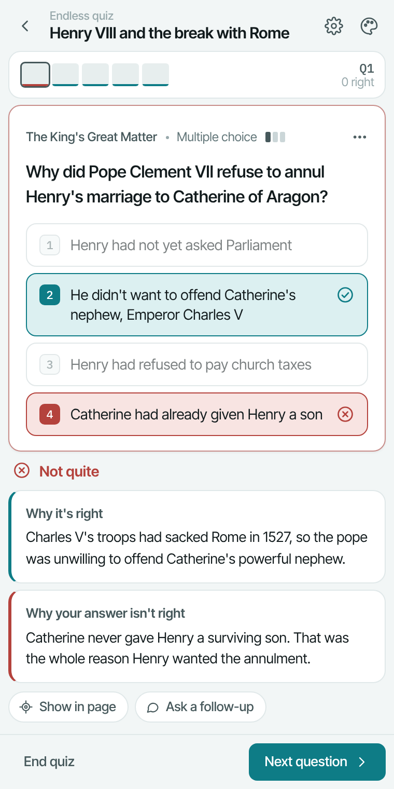
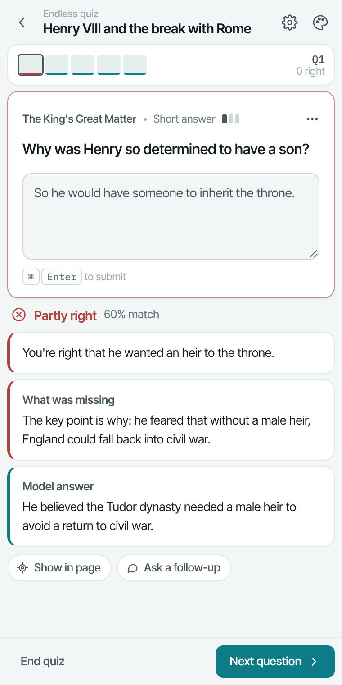
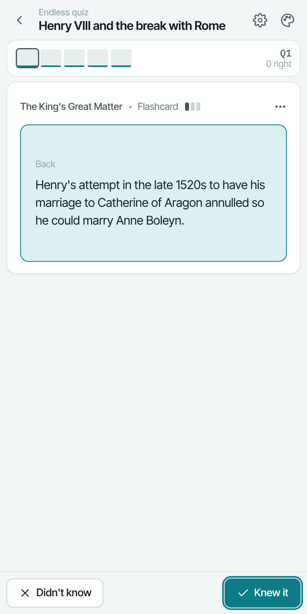
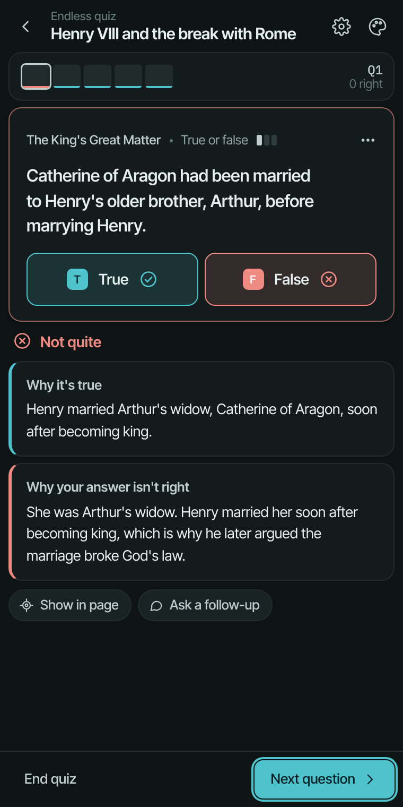

# Quizzer

A Chrome side-panel extension that turns the page you're reading, or a passage you highlight, into an endless, adaptive quiz with AI explanations. Sibling to [Noted](https://github.com/Couchkat/noted): same design system, its own Lagoon accent.



| Feedback | Short answer | Flashcard | Dark mode |
|---|---|---|---|
|  |  |  |  |

*Demo content is a sample Henry VIII reading. A sharper MP4 version is in [docs/demo/quizzer-demo.mp4](docs/demo/quizzer-demo.mp4).*

## What it does

- **Three ways to start:** *Quiz this page* or *Quiz selection* in the panel, right-click **Quiz me on this**, or the **Quiz me** chip that appears when you highlight 15+ words.
- **Four question types:** multiple choice, true or false, short answer (graded by the AI), flashcards.
- **Endless and adaptive:** two questions are always written ahead. A missed idea comes back, reworded, within three questions; three right in a row on an idea makes its questions harder.
- **Explanations:** why the right answer is right, why your pick wasn't, **Show in page** (scrolls to and highlights the sentence the question came from), and **Ask a follow-up** for a short chat about the question.
- **Saved locally:** every quiz saves after your first answer. **Review missed questions** collects everything you got wrong, across all quizzes.

## AI

- **On this computer (default):** Chrome's built-in Gemini Nano. Free, private, works offline. Needs Chrome 138+ on a supported computer and a one-time model download (Settings → Download model).
- **API key:** Anthropic, OpenAI or Google Gemini. Paste a key in Settings; it's stored only in this browser.

## Install (developer mode)

1. Open `chrome://extensions` and turn on **Developer mode**.
2. Click **Load unpacked** and choose this `quizzer` folder.
3. Pin Quizzer and click its icon to open the side panel.

## Project layout

```
manifest.json        Manifest V3
background.js        context menu, opens the panel, hands off selections
content/chip.js      Quiz me chip + Show in page highlight
panel.html/.css      the side panel (Noted's tokens + Lagoon)
js/panel.js          appearance, current tab, screens
js/session.js        one running quiz (prefetch, answers, saving)
js/engine.js         adaptive engine, pure functions
js/source.js         page/selection → numbered passages
js/db.js             IndexedDB (sets, questions, attempts)
js/ai/               provider-neutral AI interface, Nano + API-key providers, prompts, output checks
js/views/            home, setup, quiz, chat, paste, settings
tests/               engine/parse/source tests
docs/spec.md         design spec
docs/demo/           README GIF and screenshots
```

## Tests

```
node tests/engine.test.js
```
or open `tests/engine.test.html` in Chrome and check the console.

### Manual checklist
- [ ] A Wikipedia article, a news page, a Canvas reading, and a `chrome://` page (paste fallback)
- [ ] Each question type; short answer graded; flashcard flip with Space
- [ ] Show in page highlights the right sentence; works on a tab opened before install
- [ ] On-device and API-key paths (Settings → Test)
- [ ] Light and dark in every color theme
- [ ] Keyboard only: 1–4, T/F, Space, ⌘Enter, Enter for next
